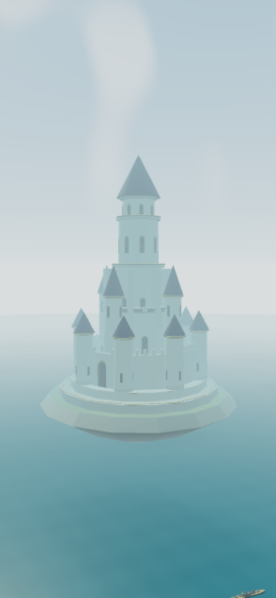
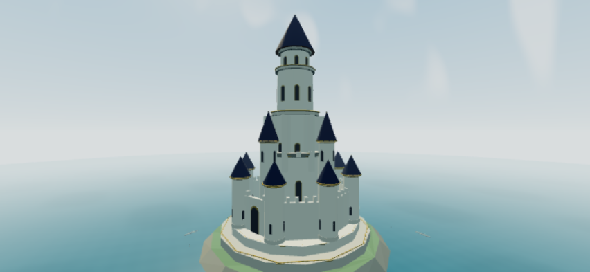

# 浮島の城の確認画像

[PR #17](https://github.com/chameleonjp-lab/uchiotose/pull/17) の城を、ゲームと同じ描画処理で撮影した画像です。全景と近景を見せるため、撮影用にカメラの位置を変えています。

城の高さは島上面から2,400m、島の最大横幅は2,000mです。城の足元半径810mは島上面に収まります。

## 全景（縦画面）

## 近景（横画面）

単体217件、既存画面12件、城の描画2件が成功し、別担当が画像も原寸で確認しました。実iPhoneでの動作・速度は未確認です。城は景観として追加し、城に機体や弾がぶつかる処理は追加していません。

検査対象コード: `3eace9ca527167058965372c589a8d9604bb8d24`。
[検査結果](https://github.com/chameleonjp-lab/uchiotose/actions/runs/38335781398) と [画像・ソースの照合記録](provenance.json)。
